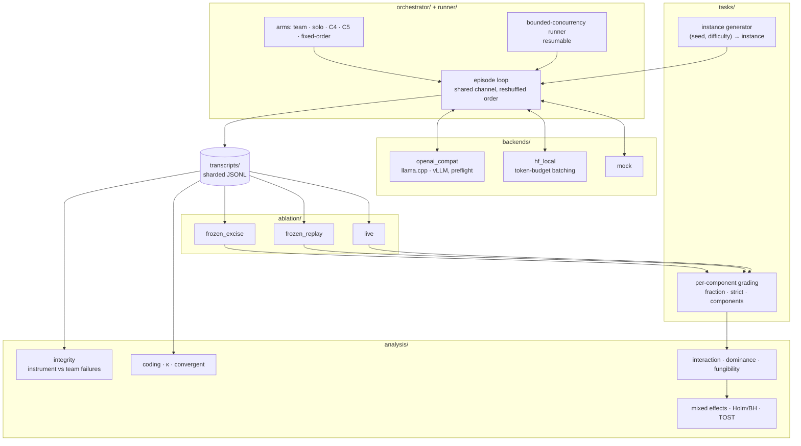
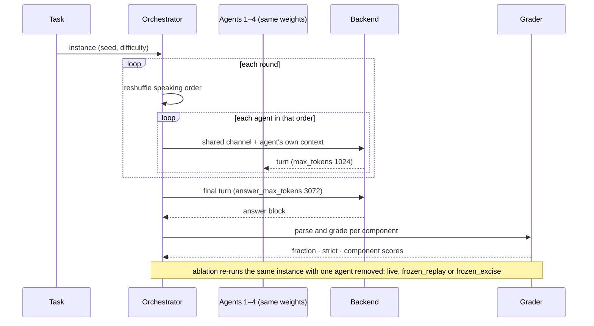
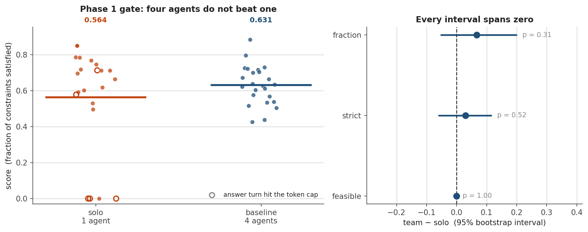
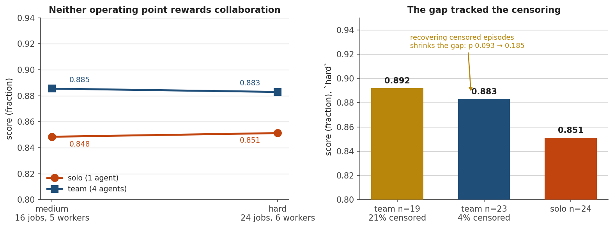
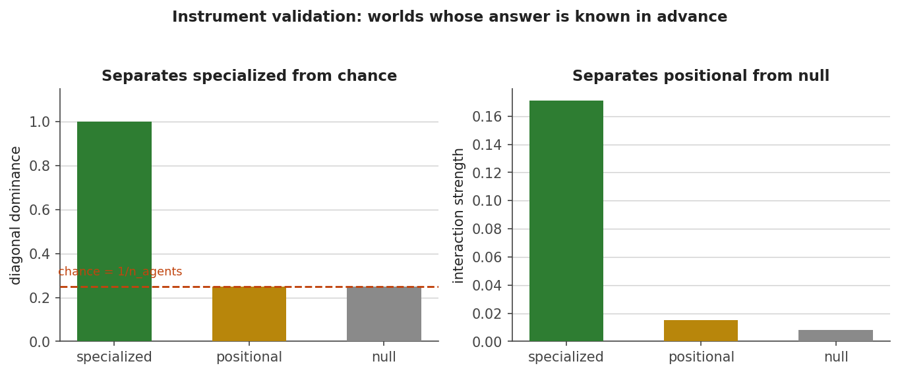

# CollabEngine-LLM

<p align="center">
  <a href="CollabEngine-LLM%20Demo.mp4">
    
  </a>
  <br>
  <sub>▶ <b><a href="CollabEngine-LLM%20Demo.mp4">Watch the CollabEngine-LLM demo</a></b> (74 s): the six phases, 191 commits, the suite on a fresh clone, then twelve live commands on the mock backend and a real corpus slice</sub>
</p>

**Give LLM agents no roles at all, then test causally whether the division of labour they invent is functionally real.**

[](pyproject.toml)
[](tests)
[](configs)
[](docs)
[](docs/PAPER-DRAFT.md)
[](pyproject.toml)

Several instances of the *same* open model share a task and a channel. Nobody is
told to plan, criticise or verify. If roles appear, the question is whether they
are functionally real or a pattern being read into transcripts — and that is
settled by ablation, not by reading.

> **The claim under test.** Emergent role differentiation in same-model LLM agent
> teams is behaviourally observable and statistically stable — but its
> transcript-derived labels predict causal contribution only weakly.

**The answer, at 8B on this task family: team size does nothing.** One agent
scores 0.579, three agents 0.574, four agents 0.576 across 899 fresh-seed
episodes, and equivalence tests exclude effects larger than one satisfied
constraint. Every positive result along the way turned out to be an instrument
artifact — and `collabengine audit` packages the diagnostic that found them.

---

## Contents

| Section | |
|---|---|
| [What it does](#what-it-does) | The framework, by area |
| [Architecture](#architecture) | Tasks, episodes, backends, ablation, analysis |
| [How an episode runs](#how-an-episode-runs) | Shared channel, reshuffled order, one answer |
| [Results](#results) | The gate, the matched budget, the ablation grid, the bounds |
| [Quick start](#quick-start) | Install, self-test, run, audit |
| [Project status](#project-status) | Phases, artifacts found, and what is left |
| [Design decisions](#design-decisions) | Three confounds, and the instrument rule |
| [Repository layout](#repository-layout) | Where things live |
| [Documentation](#documentation) | Which file answers which question |
| [Team](#team) | Who built it |

---

## What it does

| Area | Capabilities |
|---|---|
| **Tasks** | Constraint-satisfaction instances satisfiable by construction, graded per component; a second code task family |
| **Episodes** | N copies of one model on a shared channel, speaking order reshuffled every round, symmetry breakers (name, seed, scratchpad) swept |
| **Arms** | Team, solo, matched-budget solo under a group brief (C4) and a single-agent brief (C5), fixed-order control |
| **Ablation** | `live`, `frozen_replay` and `frozen_excise`, plus capacity and random-message controls, with a propagation index |
| **Analysis** | Double-centred interaction strength, diagonal dominance, fungibility, mixed-effects tests with episode as a random effect |
| **Inference** | Holm and Benjamini–Hochberg across the registered family; TOST equivalence with a pre-registered margin |
| **Observation** | Eight-action discourse coding by local or frontier judges, Cohen's κ, convergent validity |
| **Backends** | `mock` (no GPU), in-process `transformers` with token-budget batching, OpenAI-compatible client for vLLM or llama.cpp |
| **Audit** | `collabengine audit` — the verbosity, truncation and parse-failure accounting, for anyone's transcripts |

---

## Architecture



Orchestration is **hand-written on purpose**: every mainstream agent framework
ships role scaffolding in its prompt templates, which would silently plant the
structure this project claims to observe emerging.

---

## How an episode runs



---

## Results

### The Phase 1 gate does not clear

Llama-3.1-8B-Instruct (Q4_K_M, llama.cpp) on constraint-satisfaction instances,
24 episodes per arm, identical instances across arms.

| | as scored, old instrument | *d* | **answer budget** | perm *p* | solo `cut@end` |
|---|---|---|---|---|---|
| **medium** | +0.067 | +0.31 | **+0.059** | 0.269 | 7 → **0** |
| **hard** | **+0.249** | **+1.09** | **−0.026** | **0.500** | 10 → **1** |
| **xhard** | **+0.188** | +0.75 | **+0.069** | **0.263** | 15 → **1** |



**Both significant Phase 1 results were the token cap.** A solo episode is three
turns and the last one carries the entire answer; a team episode is twelve and
the last one commits an answer the transcript already contains. The same
per-turn cap landed on solo's answer and on the team's *summary* of one. A
separate budget for the one turn that gets parsed — `answer_max_tokens = 3072`,
`max_tokens` unchanged — moved solo's `hard` mean by +0.239, the whole of the
original gap.



The artifact grows with instance size, which is the shape the hypothesis
predicts: **a difficulty curve read without this control is indistinguishable
from the effect it was built to detect.** Every artifact removed has made the gap
smaller, never once the other way.

### Matched budget does not rescue the team

The team spends ~2× the output tokens across 4× the forward passes, so two
matched-budget arms give one agent the team's whole turn budget:

| team − 1 agent, `fraction` | C4 `TEAM_BRIEF` | **C5 `SOLO_BRIEF`** | the brief alone |
|---|---|---|---|
| **medium** | +0.161 (*p* = **0.009**) | **+0.142 (*p* = 0.002)** | +0.019 (*p* = 0.762) |
| **hard** | +0.102 (*p* = **0.038**) | +0.016 (*p* = 0.719) | +0.085 (*p* = 0.094) |
| **xhard** | +0.150 (*p* = **0.022**) | +0.080 (*p* = 0.161) | +0.070 (*p* = 0.319) |

A single-agent baseline needs a single-agent brief; a prompt that says "the
others" measures the harness, not the model, in the direction that flatters the
team. Re-measured on fresh seeds, the C5 contrast at `medium` falls to **+0.003**
once answer-turn truncation is dropped — the third positive result to turn out
to be the token cap.

### The ablation grid: three consistent nulls

On the pilot corpus, removing one of four agents cost **+0.055** over 192
episodes. On fresh seeds 1000–1149, with 599 usable episodes, it is **+0.003
[−0.015, +0.021]**. The three-agent arms reproduce to within 0.002 over 791
episodes; only a 48-episode baseline that drew high had moved. No participation,
no specialisation (interaction χ² = 3.73, *p* = 0.928), no compensation. The grid
was halted at its own pre-registered branch rule.

### The nulls are bounds, not absences

TOST at a margin of δ = 0.05 — one satisfied constraint, registered before it
was run:

| claim | difference | **excludes effects larger than** | at δ = 0.05 |
|---|---:|---:|---|
| team (4 agents) − one agent, fresh `medium` | −0.003 | **0.032** | equivalent |
| 4 agents − 3 agents | +0.002 | **0.025** | equivalent |
| team − matched-budget solo (C5, truncation-corrected) | +0.003 | **0.032** | equivalent |
| per-agent ablation drop | +0.003 | **0.026** | equivalent |
| fungibility Δ(frozen_replay) − Δ(live) | −0.005 | **0.056** | **not equivalent** |

"Team size does nothing" is a measurement, not a failure to find one. Fungibility
is withdrawn to a bound: compensation of up to about 0.06 cannot be excluded.

### A fourth artifact: the answer parser

A rebuilt corpus showed a +0.081 team gap at *p* < 0.001. It is **25
unparseable solo answers scored 0.000, against 0 in the team arm**; among
well-formed episodes the single agent leads by 0.025. Qwen2.5-7B shows 0.0%
malformed in both arms, so this is a model-by-parser interaction. Recorded, not
fixed: changing the parser changes the instrument.

### Phase 2 finds no role differentiation either

468 messages coded against an eight-action taxonomy: agents within an episode
differ no more than shuffled labels (*p* = 0.45), and no identity carries a
stable tendency (*p* = 1.00). The one robust behavioural result is between
conditions — **teams generate and lone agents audit** (propose share 0.674 vs
0.403, *p* < 0.0001). A human rater puts the current judge at **κ = 0.072**,
exposing an `organize` label that reads task content rather than the discourse
act; model-vs-model κ is blind to two models sharing a misreading.

---

## Quick start

> No GPU is needed for anything in steps 1–2 or step 4. The mock backend runs the
> whole pipeline end to end.

```bash
# 1 — install the exact stack the corpus came from
pip install -r requirements.lock.txt
pip install -e ".[dev,analysis]" --no-deps
pytest -q                                   # 439 tests, seconds

# 2 — validate the instrument before trusting it
collabengine selftest

# 3 — run against a real model (one 24 GB card)
collabengine pipeline --config configs/hf-local/hard.yaml --auto-difficulty
collabengine analyze  --config configs/hf-local/hard.yaml
#     or the served 4-bit instrument the results come from
scripts/ops/serve.sh --detach
python scripts/ops/preflight.py --config configs/llamacpp/xhard.yaml
scripts/experiments/served-run.sh
python scripts/analysis/gate_report.py      # every gate number in this README

# 4 — audit someone else's transcripts
collabengine audit path/to/transcripts.jsonl --threshold 2.0 --json
```



`selftest` runs three worlds whose answer is known in advance — specialised,
undifferentiated, and positional. A pipeline that reports specialisation in the
null world is manufacturing its result; catching that costs seconds.

```
arm                   eps  turns   chars/ep   tok/ep   trunc  cut@end  malformed
--------------------------------------------------------------------------------
solo                   12    144     24,000    6,000       3        3          3
team                   12    144     12,000    3,000       0        0          0

verbosity ratio: 2.00x  (solo over team, generated characters per episode)
FLAG: above the 1.50x threshold.
```

`audit` needs three fields — `arm`, `turns`, each turn's `text`
([AUDIT-SCHEMA.md](docs/AUDIT-SCHEMA.md)). A missing field is never read as a zero,
and a clean audit exits 0 just like a flagged one.

---

## Project status

**The science is done and the result is the bounded negative one**
([PAPER-DRAFT.md](docs/PAPER-DRAFT.md)). What is left is breadth and packaging,
tracked item by item in [Final Sweep.md](Final%20Sweep.md).

| Item | Status |
|---|---|
| Phase 1 gate — team vs solo across three tiers | ✅ measured, non-significant on the answer-budget instrument |
| Matched-budget controls (C4, C5) | ✅ measured; the brief effect dissolved at *n* = 48 |
| Phase 3 ablation grid | ✅ piloted, re-measured on fresh seeds, halted at its pre-registered branch rule |
| Phase 2 observational coding | ✅ null; judge validated against a human, taxonomy defect recorded |
| Second task family (code) | ✅ 1,050 episodes; the fourth artifact transfers, the gap does not (−0.0004) |
| Second model family | ✅ Qwen2.5-7B, 450 episodes, bound 0.0288; Mistral withdrawn — its chat template cannot express the briefs |
| Multiple comparisons · TOST | ✅ Holm + BH and equivalence bounds, printed by `gate_report.py` |
| Precision control | ⚠️ Q8_0 measured; the registered interaction needs a second rung |
| 14B run | ❌ built and pre-registered, cut by decision on 2026-08-22 |

**Withdrawn claims are documented, not dropped** — a `medium` comparison with
two thirds of its turns empty, a variance effect present in one arm, and a
*d* = 0.92 feasibility result that evaporated when three OOM-dropped episodes
were regenerated ([RESEARCH-LOG §4.1](docs/RESEARCH-LOG.md)).

---

## Design decisions

**Specialisation is a claim about differential contribution.** Removing any
competent agent lowers output, which proves only participation. The signature
is an **agent × task-component interaction**, so the ablation matrix is
double-centred to strip both main effects.

**One model, many contexts, is the control.** Identical weights across every
agent mean observed differentiation cannot come from model heterogeneity — the
confound prior observational work left open.

**Compensation is measured three ways.** `live` lets survivors reorganise,
`frozen_replay` regenerates them on the recorded schedule, `frozen_excise`
deletes messages with zero model calls. Agents restate the whole working answer
every turn, so excision gives nearly the smallest drop; `propagation_index()`
decides which frozen mode to trust.

**Position is not identity.** Speaking order is reshuffled every round; under a
fixed order a purely positional world scores 0.50 against a 0.25 baseline —
enough to be mistaken for the real thing.

**An identical limit is not a fair limit if the arms use it differently.** The
per-turn cap, the matched-budget truncation and the answer parser were each
identical in specification and unequal in effect, always in the direction that
flatters the team. That rule is what `audit` checks.

**Preflight before spending the card.** Three corpora were lost to conditions
detectable in seconds — an undersized slot, a server holding different weights,
a full card. `preflight.py` checks all three. On Windows, `memory_fraction`
turns silent PCIe paging into an ordinary OOM the batcher recovers from.

**The in-process path cannot run `xhard`.** A bf16 prefill materialises logits
over a 151,936-entry vocabulary at every prompt position; the tier runs on a
4-bit llama.cpp server instead, and the whole difficulty curve moved with it
([LLAMACPP-SETUP.md](docs/LLAMACPP-SETUP.md)).

---

## Repository layout

```
.
├── src/collabengine/
│   ├── tasks/          instance generation, per-component grading, prompt rendering
│   ├── orchestrator/   episode loop, team composition, turn scheduling
│   ├── backends/       mock, hf_local, openai_compat, plus anthropic / gemini judges
│   ├── ablation/       live, frozen_replay, frozen_excise, capacity and random-message controls
│   ├── analysis/       interaction, mixed effects, inference, coding, convergent, integrity, scoring
│   ├── runner/         bounded-concurrency execution with resume
│   └── transcripts/    JSONL episode records, sharded for parallel writers
├── configs/            hf-local (Qwen3-8B bf16), llamacpp (Llama-3.1-8B Q4), vllm, mock.yaml
├── scripts/
│   ├── experiments/    the scripts that cost GPU hours
│   ├── ops/            serve, guard, wait for the card, preflight
│   └── analysis/       gate_report.py, figures.py
├── tests/              439 tests, seconds, no GPU
└── docs/               plan, research log, pre-registrations, results, paper draft, figures
```

---

## Documentation

| Question | File |
|---|---|
| *What is the research design?* | [docs/PLAN.md](docs/PLAN.md) |
| *What happened, including every failure?* | [docs/RESEARCH-LOG.md](docs/RESEARCH-LOG.md) |
| *What was predicted before the episodes existed?* | [docs/PREREG-xhard.md](docs/PREREG-xhard.md) · [PREREG-phase3.md](docs/PREREG-phase3.md) · [PREREG-equivalence.md](docs/PREREG-equivalence.md) · [PREREG-families.md](docs/PREREG-families.md) · [PREREG-code.md](docs/PREREG-code.md) |
| *What are the results, in paper form?* | [docs/RESULTS.md](docs/RESULTS.md) · [docs/PAPER-DRAFT.md](docs/PAPER-DRAFT.md) |
| *What stands between this and a submission?* | [Final Sweep.md](Final%20Sweep.md) |
| *How do I audit my own transcripts?* | [docs/AUDIT-SCHEMA.md](docs/AUDIT-SCHEMA.md) · [AUDIT-TARGETS.md](docs/AUDIT-TARGETS.md) |
| *How is the 4-bit instrument served?* | [docs/LLAMACPP-SETUP.md](docs/LLAMACPP-SETUP.md) · [docs/ENVIRONMENT.md](docs/ENVIRONMENT.md) |
| *How does it relate to prior work?* | [docs/RELATED.md](docs/RELATED.md) |
| *Engineering detail* | [Technical_Details.md](Technical_Details.md) |

---

## Team

| Member | Focus |
|---|---|
| **Guru R Bharadwaj** | Design, framework, experiments, analysis and write-up |

---

## License

Copyright (c) 2026 Guru R Bharadwaj. All Rights Reserved. No use, copying, modification or distribution is permitted without written permission. See [LICENSE](LICENSE).
